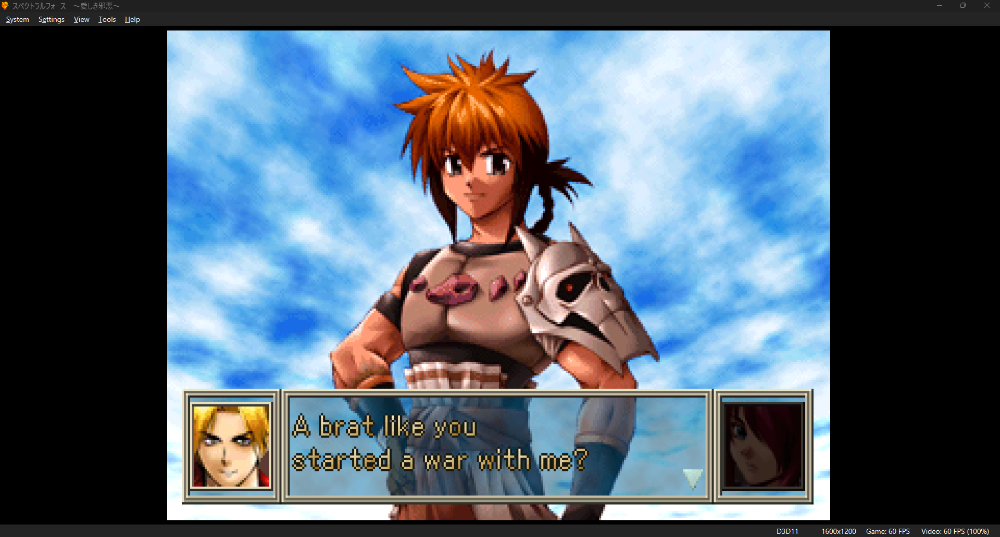
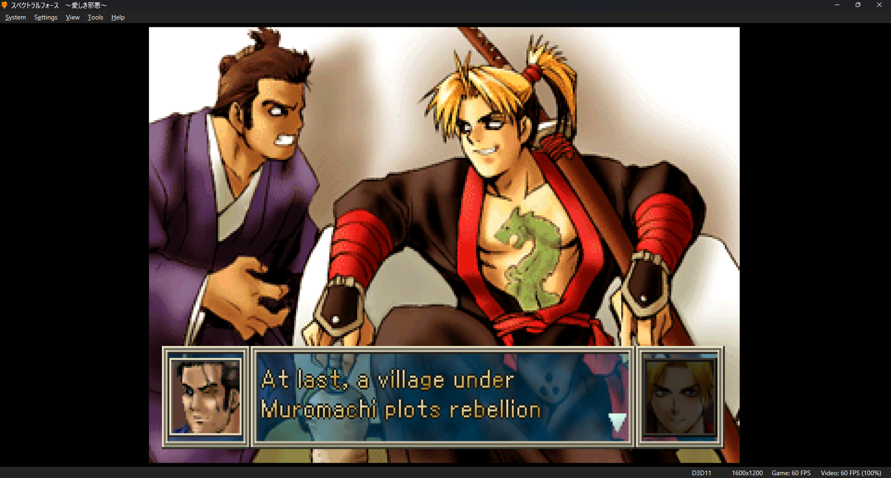
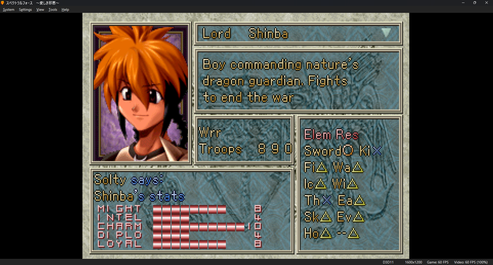
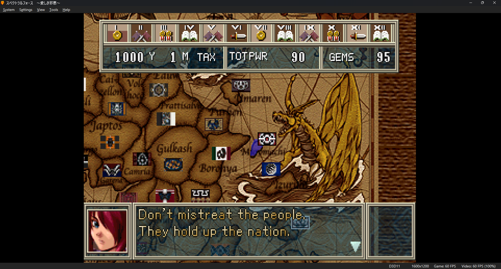
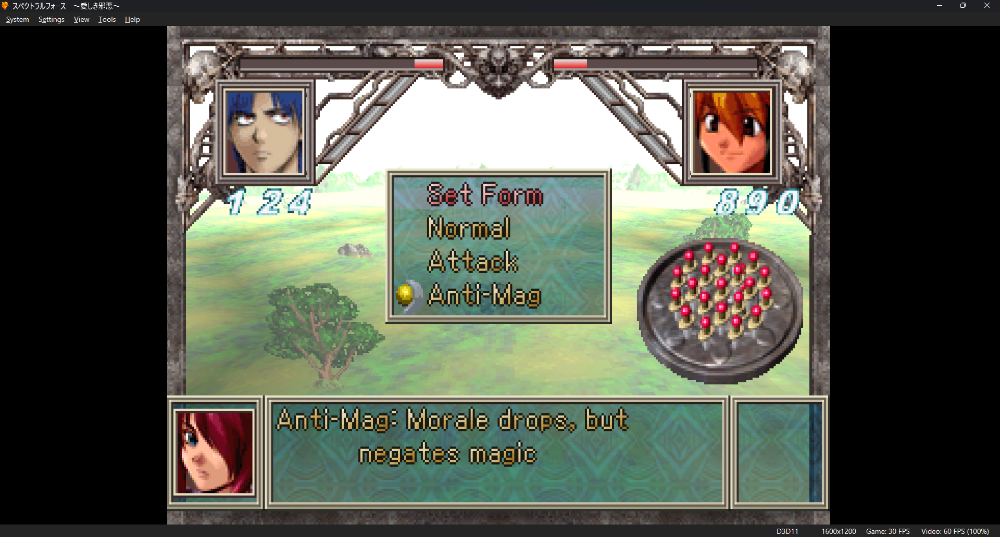

# Spectral Force: Itoshiki Jaaku English Patch

An English fan translation of *Spectral Force: Itoshiki Jaaku*
(スペクトラルフォース 〜愛しき邪悪〜, `SLPS-02233`), Idea Factory's 1999
PlayStation strategy game, released here as *Spectral Force: Lovely
Wickedness*.

This repository holds the patch tooling and the notes behind it. It does not
contain the game, and the patch only works with your own copy of the original
Japanese disc.

## Screenshots

These were taken in DuckStation from a fresh boot of the current build.

| | |
|---|---|
|  |  |
|  |  |
|  | |

## Where it stands

This is a beta. Story dialogue, menus, names, country descriptions, character
profiles and the main interface graphics are all in English. The opening
event, the first months of a campaign, and the main menus have been played
through and look right.

Be aware of a few things before you start:

- The translation was drafted with machine help and hasn't had a full human
  edit. Some lines will read stiffly.
- Nobody has finished the game on this patch yet. Screens deep into a
  campaign may still have clipped or odd text.
- Some short labels are abbreviated because they have to fit the space the
  Japanese text used ("Gems", "Wrr", "TOTPWR").
- Movie subtitles and voice audio are unchanged.

If you find a broken screen, open an issue with a screenshot and a note on how
you got there.

## Playing it

### What you need

1. **Your own dump of the Japanese disc** as a single-track BIN/CUE (the
   Redump layout). The BIN has to match exactly:

   | Check | Value |
   |---|---|
   | Size | 731,194,464 bytes |
   | CRC32 | `65c9509c` |
   | MD5 | `269709629570471394d3da77f9683b52` |
   | SHA-1 | `b188a46d82621e167dbbfc0c7b2e625ceec5f8f0` |
   | SHA-256 | `b78cfcf2ed3b471ddf3dc1eb35ea00347746da616933119eb0eeab04e7b950e7` |

   If you have a CHD, convert it first:
   `chdman extractcd -i game.chd -o game.cue -ob game.bin`.
2. **The patch**, `Spectral Force - Lovely Wickedness (English).bps`, from the
   [Releases page](https://github.com/dienp/spectral-force-3-eng-patch/releases).
3. **A BPS patcher.** Any of the three below will do.

Patch a copy of your BIN and keep the original somewhere safe.

### Option A: in the browser

Open [Rom Patcher JS](https://www.marcrobledo.com/RomPatcher.js/), pick your
`.bin` as the ROM and the `.bps` as the patch, then click **Apply patch**.
It runs locally and doesn't upload anything. The image is about 700 MB, so use
a desktop browser with some free memory.

### Option B: Floating IPS on Windows

Get `flips.exe` from <https://github.com/Alcaro/Flips/releases>, click
**Apply Patch**, choose the `.bps`, then your `.bin`, and save the result.

### Option C: Node.js

With Node.js 20 or newer and this repository checked out:

```sh
node tools/bps.mjs apply "Spectral Force - Itoshiki Jaaku (Japan).bin" "Spectral Force - Lovely Wickedness (English).bps" "Spectral Force - Lovely Wickedness (English).bin"
```

### The CUE file

Emulators open the game through a `.cue` file that names the `.bin`. Put this
next to the patched BIN as `Spectral Force - Lovely Wickedness (English).cue`:

```text
FILE "Spectral Force - Lovely Wickedness (English).bin" BINARY
  TRACK 01 MODE2/2352
    INDEX 01 00:00:00
```

If you named the BIN something else, change the name in the first line.

### Checking the result

The patched BIN should be 731,194,464 bytes with CRC32 `1ecad99b` and SHA-256
`c98714e512c436e0949cdea69f510f2ae645abc559dc11f3be1d9891aa157b97`.

Open the `.cue` in DuckStation, ePSXe, or Mednafen/Beetle PSX. It hasn't been
tried on real hardware.

### If something goes wrong

- **The patcher says the source doesn't match:** your BIN isn't the dump
  listed above. It might be a different revision, a multi-track image, or a
  file that was already patched.
- **Black screen, or the emulator can't find the game:** the `FILE` line in the
  CUE doesn't match the BIN's filename.
- **A line ends with `~`:** that text box ran out of room. Please report it.

## Translating it yourself

Everything here is plain Node.js with no dependencies, so the same pipeline
can be used to fix lines, try a different translation, or start another
language. You work from your own disc, and the scripts check the original
bytes at every step, so a wrong input fails loudly instead of producing a
broken image.

The finished English translation memory isn't in this repository. It stores
every Japanese line next to its English one, which would mean publishing the
game's script. The steps below build your own from your disc. If you want to
help with the existing translation, open an issue.

### 1. Extract the disc

```sh
node tools/psxiso.mjs extract "path/to/game.bin" work/extracted
```

This writes every file on the disc plus `manifest.json`, which records where
each file lives so it can be put back later. The text sits in three places:
the main program `SLPS_022.33`, the event file `IV_DAT.EVE`, and data blocks
inside `CG_01.DAT` and `CG_02.DAT`.

### 2. Pull out the text

```sh
node tools/texttool.mjs extract work/extracted/SLPS_022.33 work/text/executable-strings.json
node tools/texttool.mjs extract-raw-grouped work/extracted/IV_DAT.EVE work/text/event-strings-grouped.json
node tools/datatext.mjs extract work/extracted work/text/data-strings.json
node tools/build-translation-memory.mjs work/text/executable-strings.json work/text/event-strings-grouped.json work/translation/memory.en.json
```

The translation memory gives every unique line a stable id (`tm_00001` and so
on), so a line that appears in 40 events is translated once. Names, country
descriptions and profiles live in a separate catalog: copy
`data-strings.json` to `work/translation/data.en.json` and add a
`translation` field to each entry you translate.

### 3. Translate

Fill in the `translation` field of each entry. A few rules matter:

- **Keep the control codes.** `#n` is a line break, and `#0` to `#9` change
  the text colour. Copy them through exactly.
- **Stay within `maxBytes`.** Each line has to fit in the bytes the Japanese
  used. Plain ASCII is one byte per letter, and the font patch packs two narrow
  letters into one glyph, so English usually fits. The build stops and names
  the line if it doesn't.
- **Some screens only draw full-width capitals.** The stat bars on the
  Personal data screen use a separate small font with katakana, full-width
  `Ａ`-`Ｚ`, digits and a handful of symbols. Labels there have to look like
  `ＭＩＧＨＴ`.
- **Watch the box sizes.** Each text window has a fixed number of glyph slots.
  The build writes `glyph-budget.json`, which flags windows that overflow or
  are nearly full.

`tools/translate-ollama.mjs` can draft untranslated lines with a local model
if you want a starting point. Read what it produces before you trust it.

### 4. Build the disc

```sh
node tools/build-english.mjs "path/to/game.bin" work/extracted work/translation/memory.en.json work/release --budgets=work/translation/window-budgets.en.json --relocations=work/translation/relocations.en.json
```

One command does the whole thing:

1. Patches the font routine and writes your translations into the program.
2. Inserts the event dialogue.
3. Edits the title and interface graphics.
4. Writes the names and profiles.
5. Puts the four changed files back into a copy of the BIN and recomputes the
   CD error-correction data.

The original BIN is checked against its known hash and never modified. The
output folder gets the new BIN/CUE and a `build-report.json` with hashes.

The two optional flags give a few lines more room than the Japanese had:

- `--relocations` moves the listed strings into unused space in the program.
- `--budgets` raises the glyph limit of the listed windows.

Both check the original instructions before touching anything. If you don't
have the list files, leave the flags off. [TOOLKIT.md](TOOLKIT.md) covers
their file formats and the rest of the tools.

### 5. Test it

Boot the new CUE in an emulator and look at the screens you changed. Checking
the files isn't enough: text that fits the bytes can still overflow a window
or run past a panel's edge. Close the emulator before rebuilding into the
same folder, because it keeps the BIN locked.

### 6. Make a patch

```sh
node tools/bps.mjs create "path/to/game.bin" "work/release/Spectral Force - Lovely Wickedness (English).bin" "work/release/patch.bps"
```

The patch holds only the changed bytes, so it can be shared without
distributing the game.

## What was hard

A few problems took real digging. The full evidence, with addresses, is in
[RESEARCH.md](RESEARCH.md), and the running log is in
[PROGRESS.md](PROGRESS.md).

- **ASCII didn't render.** The dialogue renderer only knew two-byte
  Shift-JIS, so English came out blank. A small hook in unused program space
  now draws ASCII from the game's own Latin glyphs, with proportional spacing.
- **Text boxes have a glyph limit.** Each window reserves a fixed number of
  glyph slots from a shared pool of 256, and anything past the limit becomes a
  `~`. The build reports every window, and a handful have been raised where
  the pool had room.
- **Longer strings.** Some labels needed more bytes than the Japanese had.
  About 5 KB of leftover debug code that the game never runs now holds the
  longer versions, and every reference is repointed and checked.
- **Events ended early.** The event script carries on reading right after
  each line of text. Padding short lines with zero bytes made it think the
  scene was over. Short lines are now padded with a code the renderer skips.
- **A second font.** The stats panel uses its own 8x8 font that reads two
  bytes per character. One stray ASCII label shifted everything after it and
  scrambled the panel.

## Repository layout

| Path | What's there |
|---|---|
| `tools/` | Extraction, insertion, patching, analysis and disc-rebuild scripts |
| `examples/` | Small sample catalogs |
| `screenshots/` | In-game screenshots of the current build |
| `TOOLKIT.md` | Per-tool reference |
| `RESEARCH.md` | Reverse-engineering findings and evidence |
| `PROGRESS.md` | Progress log, open problems and next steps |
| `PATCHING.md` | Player instructions that ship with the patch |
| `AGENTS.md` | Working rules for the project |

`work/` is where extracted and generated files go. It's ignored by git and
should never be committed.

## Legal

This is an unofficial fan project. *Spectral Force* belongs to Idea Factory.
The repository and the patch contain no game files, only tools, notes and the
changed bytes needed to turn your own copy into the English version. Please
support the original release.
